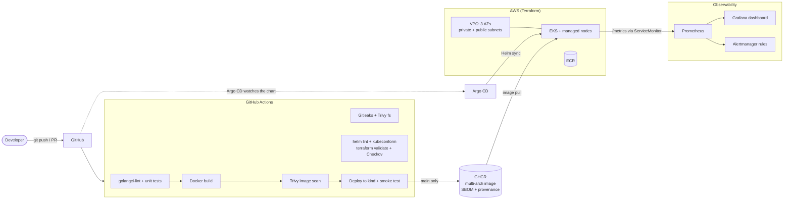

# DevOps End-to-End Platform

[](https://github.com/Paulo31209/devops-e2e-platform/actions/workflows/ci.yml)
[](LICENSE)


A small Go API taken all the way from code to a production-style Kubernetes deployment:
**container → CI with security gates → end-to-end test on a real cluster → registry → Helm → GitOps → AWS infrastructure as code → metrics, dashboards and alerts.**

The application is intentionally simple (an in-memory notes API). The point of the project is everything around it.

---

## Architecture



## What's inside

| Layer | Implementation |
|---|---|
| **App** | Go 1.26, stdlib router, structured JSON logs (`slog`), graceful shutdown, `/healthz`, `/readyz`, `/metrics` |
| **Container** | Multi-stage build → `distroless/static:nonroot`, no shell, runs as UID 65532, cross-compiled for amd64/arm64 |
| **CI** | Lint, race-detector tests, Gitleaks, Trivy (deps, secrets, misconfig, image), Helm + kubeconform, Terraform + Checkov |
| **E2E** | Every PR deploys the chart to a throwaway **kind** cluster and runs [`scripts/smoke-test.sh`](scripts/smoke-test.sh) through the Service |
| **Delivery** | Image pushed to GHCR from `main` with SBOM and provenance attestations; `vX.Y.Z` tags create a GitHub release |
| **Kubernetes** | Helm chart with hardened security context, probes, PDB, HPA, topology spread, NetworkPolicy, Ingress |
| **GitOps** | [Argo CD Application](deploy/argocd/application.yaml) with automated sync, prune and self-heal |
| **IaC** | Terraform for VPC (3 AZs, flow logs), EKS (access entries, managed add-ons) and ECR (immutable tags, KMS, scan on push) |
| **Observability** | Prometheus metrics (RED), ServiceMonitor, PrometheusRule alerts, Grafana dashboard as code |
| **Supply chain** | Actions pinned to commit SHAs, Dependabot for Go, Actions, Docker and Terraform, pre-commit hooks |

---

## Quick start

### 1. Run locally (Go only)

```bash
make run
curl -s localhost:8080/healthz
curl -s -X POST localhost:8080/api/v1/notes -d '{"title":"first note","body":"hello"}'
curl -s localhost:8080/api/v1/notes
```

### 2. Full local stack with metrics (Docker)

```bash
make up
```

| Service | URL |
|---|---|
| API | http://localhost:8080 |
| Prometheus | http://localhost:9090 |
| Grafana (dashboard "Notes API") | http://localhost:3000 |

### 3. Kubernetes on your machine (kind + Helm)

```bash
make kind-up      # create the cluster
make deploy       # build image, load it into kind, helm install
make smoke        # port-forward and run the smoke test
make kind-down
```

### 4. AWS (Terraform)

> ⚠️ EKS, NAT gateways and EC2 nodes are billed by the hour. Check the AWS pricing pages and run `terraform destroy` when you are done.

```bash
cd infra/terraform/aws
cp terraform.tfvars.example terraform.tfvars   # set your IP in cluster_endpoint_public_access_cidrs
terraform init
terraform plan -out=tfplan
terraform apply tfplan
$(terraform output -raw configure_kubectl)
```

Then install the monitoring stack and Argo CD, and apply the Application:

```bash
helm repo add prometheus-community https://prometheus-community.github.io/helm-charts
helm upgrade --install monitoring prometheus-community/kube-prometheus-stack \
  -n monitoring --create-namespace -f deploy/observability/kube-prometheus-stack-values.yaml

kubectl create namespace argocd
kubectl apply -n argocd --server-side -f https://raw.githubusercontent.com/argoproj/argo-cd/stable/manifests/install.yaml
kubectl apply -f deploy/argocd/application.yaml
```

Run `make help` to list every target.

---

## API

| Method | Path | Description |
|---|---|---|
| `GET` | `/healthz` | Liveness: process is up |
| `GET` | `/readyz` | Readiness: returns `503` while draining on shutdown |
| `GET` | `/version` | Build version (injected with `-ldflags`) |
| `GET` | `/metrics` | Prometheus metrics |
| `GET` | `/api/v1/notes` | List notes |
| `POST` | `/api/v1/notes` | Create a note: `{"title": "...", "body": "..."}` |
| `GET` | `/api/v1/notes/{id}` | Get a note |
| `DELETE` | `/api/v1/notes/{id}` | Delete a note |

**Metrics exposed:** `http_requests_total{method,route,code}`, `http_request_duration_seconds` (histogram), `notes_stored`, `app_build_info{version}` plus Go runtime and process metrics.

---

## Technical decisions

| Decision | Why |
|---|---|
| **Go + distroless** | Static binary, tiny attack surface: the runtime image has no shell or package manager for an attacker to use. |
| **Route label = matched pattern** | Using `/api/v1/notes/{id}` instead of the raw path keeps Prometheus label cardinality bounded. |
| **Readiness fails before shutdown** | On `SIGTERM` the pod reports not-ready, then drains for up to 20s; `terminationGracePeriodSeconds` is 30s so in-flight requests finish. |
| **`maxUnavailable: 0` + PDB** | Rolling updates and node drains never take the service below one ready replica. |
| **CPU request, no CPU limit** | Avoids CFS throttling on a latency-sensitive service; memory has a limit because it is not compressible. |
| **E2E on kind in CI** | Lint and unit tests can't catch a broken probe, port or security context. Deploying the real chart to a real cluster can. |
| **Build once on PR, push only on `main`** | PRs from forks never get registry credentials; published images always passed every gate. |
| **Actions pinned by SHA** | Tags can be moved by an attacker; a commit SHA can't. Dependabot updates the SHA and the version comment together. |
| **Terraform registry modules** | `terraform-aws-modules` VPC/EKS are widely used and reviewed; custom code is kept to what is project-specific (ECR, KMS). |
| **Checkov skips are documented** | Each skipped check in [`.checkov.yaml`](.checkov.yaml) has a written justification instead of a silent ignore. |
| **In-memory storage** | Keeps the focus on the platform. Swapping in PostgreSQL (RDS + a StatefulSet for local dev) is on the roadmap. |

---

## Repository layout

```text
.
├── cmd/server/                  # main: config, HTTP server, graceful shutdown
├── internal/
│   ├── httpapi/                 # handlers, metrics middleware, tests
│   └── notes/                   # thread-safe in-memory store, tests
├── deploy/
│   ├── helm/notes-api/          # Helm chart (+ Grafana dashboard JSON)
│   ├── argocd/                  # Argo CD Application (GitOps)
│   └── observability/           # Prometheus/Grafana config, kube-prometheus-stack values
├── infra/terraform/aws/         # VPC, EKS, ECR
├── scripts/smoke-test.sh        # end-to-end checks used by CI and `make smoke`
├── .github/workflows/           # ci.yml, release.yml
├── Dockerfile                   # multi-stage, distroless
├── docker-compose.yml           # API + Prometheus + Grafana
└── Makefile
```

## Releasing

Commits follow [Conventional Commits](https://www.conventionalcommits.org/). To publish a version:

```bash
git tag v0.1.0 && git push origin v0.1.0
```

The release workflow pushes `ghcr.io/paulo31209/devops-e2e-platform:0.1.0` (and `:0.1`) and creates a GitHub release with generated notes.

## Roadmap

- [ ] PostgreSQL storage (RDS in Terraform, migrations in CI)
- [ ] Sign images with cosign (keyless, GitHub OIDC) and verify them in the cluster
- [ ] GitHub OIDC → AWS IAM role for `terraform plan` on pull requests (no long-lived keys)
- [ ] Automated image tag promotion to the GitOps config after a release
- [ ] Distributed tracing with OpenTelemetry

## License

[MIT](LICENSE)
